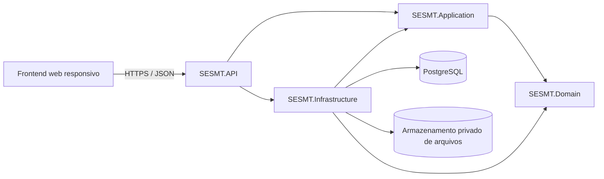
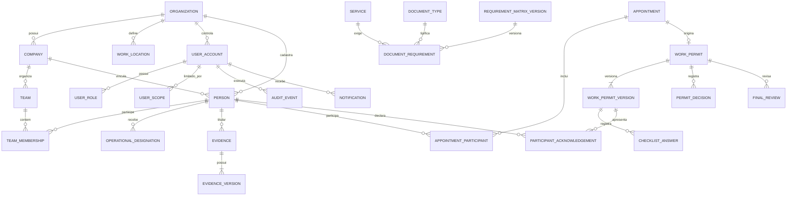

# Entrega 2 — Especificação técnica do SESMT PT Digital

**Status:** especificação para revisão da equipe.  
**Escopo:** projeto técnico do MVP; este documento não afirma que os componentes descritos já estejam implementados.  
**Repositório e versão consultados:** branch `main` do SESMT; cartões dos quadros Trello “SESMT — PT Digital (MVP)” e “SESMT — Gestão Documental”.  
**Dados de demonstração:** exclusivamente fictícios. O produto não está autorizado por este documento para uso operacional real.

## 1. Objetivo e limites do MVP

O sistema organiza o ciclo de uma Permissão de Trabalho (PT): cadastro do contexto e dos participantes, documentos/evidências, agendamento, abertura em campo, checklist, ciência individual, validação de bloqueios, liberação, execução, conclusão e revisão final.

O MVP contempla os cinco serviços apresentados no quadro: trabalho em altura, trabalho a quente, trabalho a frio, espaço confinado e eletricidade. Uma PT pode combinar serviços; a avaliação usa a união dos requisitos aplicáveis a todos os serviços, funções e participantes.

Ficam fora do MVP: LMS ou gestão completa de treinamentos, módulos clínicos, notificações externas obrigatórias e integração com sistemas externos. A matriz e os documentos de demonstração são exemplos fictícios, nunca uma declaração de aptidão profissional.

**Regra central de segurança:** agendamento, abertura, upload, ciência ou assinatura visual não liberam trabalho. A liberação, o início e a retomada são comandos distintos, autorizados e validados no servidor. Evidência ausente, vencida, reprovada ou ainda não conferida bloqueia a ação pertinente.

## 2. Arquitetura da solução

### 2.1 Componentes e responsabilidades

A solução existente é uma base de cinco projetos .NET 10. Preservar o sentido das dependências:



| Componente | Responsabilidade técnica |
| --- | --- |
| Frontend | Telas e fluxos responsivos, validação de usabilidade, consumo dos contratos HTTP e apresentação de estados. A autorização real continua no servidor. |
| `SESMT.API` | Controllers, autenticação/autorização HTTP, validação de entrada, códigos HTTP, middleware de erros, OpenAPI e composição da aplicação. Controllers não implementam regras de domínio. |
| `SESMT.Application` | Casos de uso, DTOs, validações, políticas de aplicação, interfaces de repositório/serviço e coordenação transacional. |
| `SESMT.Domain` | Entidades, Value Objects, estados, invariantes e eventos de domínio, sem dependência de ASP.NET Core, EF Core ou PostgreSQL. |
| `SESMT.Infrastructure` | EF Core/Npgsql, mapeamentos, migrations, repositórios, armazenamento privado de arquivos e serviços técnicos. |
| `SESMT.Tests` | Testes unitários do domínio/aplicação, testes de arquitetura e testes de integração da API com PostgreSQL isolado. |

**Organização sugerida por módulo:** `IdentityAccess`, `Organization`, `Workforce`, `Documents`, `WorkPermits`, `Scheduling`, `Audits` e `Notifications`. Corrigir a grafia atual `IdentityAcess` ao iniciar a implementação, preservando compatibilidade de namespaces/commits se já houver código dependente.

### 2.2 Justificativas

- Clean Architecture mantém as regras de segurança operacional testáveis sem banco ou HTTP e impede que detalhes do fornecedor contaminem o domínio.
- PostgreSQL com EF Core/Npgsql atende relações, transações, índices, constraints, migrations e concorrência otimista; arquivos binários ficam fora das tabelas, em armazenamento privado, com metadados e referências no banco.
- Modularizar por capacidade do produto facilita entregar F1–F4 em sequência sem criar microserviços antes de haver necessidade.
- API REST/JSON sobre HTTPS permite integrar o frontend existente sem acoplar a interface à persistência.
- A trilha de auditoria e versões preserva decisões históricas sem permitir que uma alteração atual reescreva o que foi visto ou aprovado anteriormente.

### 2.3 Estado observado do código

Na branch `main` consultada, há projetos de esqueleto, controlador de exemplo, inicialização básica da API e teste vazio. O inventário consultado não apresenta entidades de negócio, DbContext, repositórios, migrations, EF Core/Npgsql ou configuração de autenticação. A descrição do cartão F0 cita entidades/middleware que não aparecem nesse inventário; confirmar com a equipe qual branch/commit contém essa base antes de reaproveitá-la.

## 3. Modelo de dados

### 3.1 Convenções e integridade

- Chaves primárias UUID; datas gravadas em UTC; datas civis de validade como `date`.
- Cada registro de negócio pertence a uma organização e, quando aplicável, a uma empresa/local. FKs compostas ou validações equivalentes impedem cruzar tenants.
- Exclusão lógica/desativação para cadastros que tenham histórico; não apagar decisões, versões ou auditoria.
- `row_version`/token de concorrência em recursos alteráveis; comandos que dependam de versão devem rejeitar versão obsoleta com `409`.
- Unicidade contextual: e-mail de conta normalizado; número de versão por agregado; requisito por versão/serviço/função; ciência por participante e versão; chave de idempotência por ator e comando quando aplicável.
- Retenção, limite de arquivo, formatos permitidos, regras reais de validade e política de backup são parâmetros a validar antes de piloto; não fixar prazo legal por suposição.

### 3.2 Entidades, atributos e relações

Atributos abaixo são o contrato lógico inicial. `id` é PK em cada entidade; FKs são indicadas explicitamente.

| Entidade | Atributos essenciais e chaves | Relações e regras |
| --- | --- | --- |
| `Organization` | `id`, `name`, `active`, `created_at` | Raiz do escopo de tenant. |
| `Company` | `id`, `organization_id` FK, `name`, `kind` (contratante/prestadora), `active` | Organização 1:N empresas; prestadora só consulta seu escopo e vínculos autorizados. |
| `WorkLocation` | `id`, `organization_id` FK, `company_id` FK nullable, `name`, `address`, `active` | Local pertence à organização e opcionalmente à empresa. |
| `UserAccount` | `id`, `organization_id` FK, `email_normalized` UNIQUE contextual, `password_hash`, `active`, `created_at` | Conta de acesso não equivale a pessoa nem a competência profissional. |
| `UserRole` | `user_id` FK, `role` enum | N:M conta/perfis. Perfis propostos: administrador, chefe, participante, técnico/bombeiro e engenheiro/revisor. |
| `UserScope` | `user_id` FK, `organization_id`/ `company_id`/ `team_id` FKs nullable | Escopo explícito de leitura/gestão; conferir consistência do nível e tenant. |
| `Person` | `id`, `organization_id` FK, `company_id` FK nullable, `name`, `contact` nullable, `active` | Pessoa pode existir sem conta. Não exigir CPF nem dado médico por padrão. |
| `Team` | `id`, `organization_id` FK, `company_id` FK, `name`, `active` | Equipe de uma prestadora/empresa no tenant. |
| `TeamMembership` | `id`, `team_id` FK, `person_id` FK, `role_name`, `valid_from`, `valid_to` nullable | Histórico temporal de vínculo/função; não sobrescrever função capturada em PT. |
| `Service` | `id`, `code` UNIQUE, `name`, `active` | Catálogo dos cinco serviços do MVP; códigos estáveis usados por contratos. |
| `OperationalDesignation` | `id`, `organization_id` FK, `person_id` FK, `kind` (atender/liberar/revisar/conferir), `valid_from`, `valid_to`, `revoked_at`, `revoked_by` FK | N:M com serviços e locais por tabelas `DesignationService` e `DesignationLocation`; perfil não substitui designação. Revogar impede novas decisões e mantém decisões passadas. |
| `DocumentType` | `id`, `organization_id` FK, `name`, `classification` (administrativa/restrita), `active` | Tipos configuráveis; classificação restrita exige autorização específica. |
| `RequirementMatrixVersion` | `id`, `organization_id` FK, `version`, `status`, `created_by` FK, `created_at` | Versões imutáveis após uso; publica regras por serviço/função/tipo documental. |
| `DocumentRequirement` | `id`, `matrix_version_id` FK, `service_id` FK, `role_name`, `document_type_id` FK, `required`, `validity_rule` JSON estruturado | Matriz de requisitos. Para serviço combinado, união das regras aplicáveis a cada função/participante. |
| `Evidence` | `id`, `organization_id` FK, `owner_person_id` FK nullable, `company_id` FK nullable, `team_id` FK nullable, `document_type_id` FK, `status`, `issued_on`, `expires_on` nullable, `created_by` FK, `created_at` | Metadados da evidência. Titular e contexto compatíveis; upload inicia em aguardando conferência. |
| `EvidenceVersion` | `id`, `evidence_id` FK, `version`, `storage_key`, `media_type`, `size_bytes`, `sha256`, `uploaded_by` FK, `uploaded_at`, `review_status`, `reviewed_by` FK nullable, `reviewed_at` nullable, `review_reason` nullable | Arquivo privado por versão; não sobrescrever binário. Nova versão exige nova análise. |
| `Appointment` | `id`, `organization_id` FK, `requested_by` FK, `company_id` FK, `location_id` FK, `team_id` FK, `service_ids`, `scheduled_at`, `status`, `row_version` | Participantes em `AppointmentParticipant`; eventos de reagendamento/cancelamento conservam antes/depois. Uma PT por agendamento é a proposta inicial, pendente de DC-06. |
| `AppointmentParticipant` | `appointment_id` FK, `person_id` FK, `role_snapshot` | Associação N:M; guardar função contextual. |
| `WorkPermit` | `id`, `organization_id` FK, `appointment_id` FK UNIQUE (proposta), `operational_status`, `review_status`, `current_version`, `row_version`, `opened_at`, `opened_by` FK | Agregado da PT. Status operacional separado da revisão final. A relação agendamento–PT precisa de DC-06. |
| `WorkPermitVersion` | `id`, `work_permit_id` FK, `version`, `template_version`, `matrix_version`, `context_snapshot` JSON, `created_by` FK, `created_at`, `content_hash` | Snapshot imutável de serviço/local/equipe/pessoas/funções e configuração apresentada. Correção relevante gera nova versão. |
| `ChecklistAnswer` | `id`, `permit_version_id` FK, `question_id`, `answer`, `answered_by` FK, `answered_at` | Pergunta obrigatória ausente ou resposta impeditiva impede liberação. |
| `ParticipantAcknowledgement` | `id`, `permit_version_id` FK, `person_id` FK, `collected_by` FK, `method`, `purpose`, `acknowledged_at`, `evidence_reference` nullable | Única por participante/versão/método conforme decisão; declarante e coletor distintos; não herdar ciência para nova versão. |
| `PermitDecision` | `id`, `work_permit_id` FK, `permit_version_id` FK, `decision`, `actor_id` FK, `reason` nullable, `occurred_at`, `idempotency_key` | Decisões de liberar/iniciar/suspender/retomar/concluir/cancelar; guarda autor, versão e horário; não mutável por operação comum. |
| `FinalReview` | `id`, `work_permit_id` FK, `permit_version_id` FK, `reviewer_id` FK, `decision` (aprovada/devolvida), `reason` nullable, `reviewed_at` | Somente revisor designado; devolução exige motivo; versão aprovada fica imutável; revisão não libera trabalho retroativamente. |
| `AuditEvent` | `id`, `organization_id` FK, `actor_id` FK nullable, `declarant_id` FK nullable, `action`, `resource_type`, `resource_id`, `version` nullable, `occurred_at`, `result`, `trace_id` | Append-only para operação comum; sem senhas, tokens, conteúdo de arquivo ou dados médicos. |
| `Notification` | `id`, `recipient_user_id` FK, `event_id` FK, `type`, `resource_id`, `created_at`, `read_at` nullable | Deduplicar por evento/destinatário; leitura não altera estado operacional. |

### 3.3 Diagrama Entidade-Relacionamento

O diagrama representa as relações centrais. Tabelas de junção de serviços/locais em designações e valores de enumeração foram omitidas por legibilidade; todas as relações devem incluir a chave de tenant apropriada.



### 3.4 Restrições essenciais

1. A FK do contexto e a autorização são verificadas no servidor em toda leitura, contagem, filtro, exportação, download e comando.
2. Não liberar/iniciar/retomar se a designação estiver ausente, expirada, revogada ou não cobrir todos os serviços e locais da PT.
3. Recalcular requisitos no momento de cada comando crítico: evidências aplicáveis de todos os participantes devem estar presentes, vigentes e aceitas; checklist obrigatório deve estar respondido sem impedimento.
4. Datas/validade e vínculos são revalidados dentro da transação da decisão. Conflitos de `row_version` retornam `409`; repetição idempotente não cria segunda decisão.
5. Um evento histórico não é apagado por desativação de conta, vínculo ou designação. Retenção e expurgo de arquivos ficam sujeitos à decisão de produto/legal DC-11/12.

## 4. Contratos da API

### 4.1 Convenções

Prefixo `/api/v1`; JSON UTF-8; datas e horários RFC 3339 em UTC; UUID em minúsculas; paginação `page` (1-based) e `pageSize` limitado pelo servidor. A identidade, papel, empresa e escopo do ator vêm do token e do servidor, nunca de campos confiados do frontend.

- Sucesso: `200` consulta/alteração, `201` criação com `Location`, `204` operação sem corpo.
- Erro padronizado: `{ "code": "validation_error", "message": "...", "traceId": "...", "errors": [{ "field": "...", "code": "...", "message": "..." }] }`.
- Códigos: `400` formato/filtro inválido; `401` não autenticado; `403` perfil/escopo/designação insuficiente; `404` inexistente ou fora do escopo; `409` conflito de versão/duplicidade; `413` arquivo acima do limite; `415` tipo de arquivo não aceito; `422` regra de negócio impede a operação; `429` limite de tentativas; `500` erro inesperado com `traceId`, sem detalhe interno.
- Comandos críticos aceitam `Idempotency-Key`; comandos sobre versões recebem `If-Match`/versão esperada.
- Contratos abaixo são a proposta inicial para alinhamento entre API e frontend. Os cartões de produto indicam que nomes e decisões dependentes de DC devem ser confirmados antes da implementação.

### 4.2 Autenticação, contas e designações

| Método e rota | Objetivo e autorização | Entrada principal | Saída e regras |
| --- | --- | --- | --- |
| `POST /auth/login` | Iniciar sessão; público, com rate limit | `{ email, password }` | `200 { accessToken, expiresIn, user }`; credenciais inválidas sempre resposta genérica. |
| `POST /auth/refresh` | Renovar sessão; refresh token válido | Cookie/token de renovação | Novo par de tokens; rotação e revogação do anterior. |
| `POST /auth/logout` | Encerrar sessão autenticada | Refresh token corrente | `204`; revogar token de renovação. |
| `GET /auth/me` | Contexto atual | — | Usuário, perfis e escopos efetivos; nunca designação presumida pelo cargo. |
| `GET /users`, `POST /users` | Consultar/criar conta; administrador no escopo | Filtros ou `{ nome, email, roles, scopeIds }` | Lista paginada ou `201`; pessoa não precisa de conta. |
| `PATCH /users/{id}`, `POST /users/{id}/deactivate` | Editar/desativar; administrador no escopo | Campos permitidos / versão esperada | Conta atualizada; desativação preserva autoria e histórico. |
| `GET /designations`, `POST /designations` | Consultar/criar designação; administrador autorizado | pessoa, tipo, `serviceIds`, `locationIds`, validade, origem | `201`; perfil da conta não concede competência técnica. |
| `POST /designations/{id}/revoke` | Revogar designação | motivo, versão esperada | `204`; bloqueia novas decisões, conserva as anteriores. |

### 4.3 Organização, documentos e agenda

| Método e rota | Objetivo e autorização | Entrada principal | Saída e regras |
| --- | --- | --- | --- |
| `GET/POST /companies`, `GET/PATCH /companies/{id}` | Empresas contratantes/prestadoras no escopo | nome, tipo, estado | DTO sem dados de outro tenant; validar organização pai. |
| `GET/POST /locations` | Locais de trabalho | empresa opcional, nome, endereço | Lista/criação; escopo do local obrigatório. |
| `GET/POST /teams`, `GET /teams/{id}` | Equipes e chefe responsável | empresa, nome, membros e funções | Relações temporais; preservar função usada na PT. |
| `GET/POST /people`, `PATCH /people/{id}` | Participantes sem exigir login | nome, empresa, contato opcional | DTO mínimo; CPF e dados médicos não obrigatórios. |
| `POST /documents` | Criar metadados de evidência | titular/contexto, tipo, emissão/validade | `201`, estado inicial `aguardando_conferencia`. |
| `POST /documents/{id}/versions` | Upload de nova versão | multipart `file`, metadados e hash gerado no servidor | `201`; validar tamanho, extensão, MIME, assinatura do arquivo, malware e autorização. |
| `GET /documents`, `GET /documents/{id}` | Buscar metadados e histórico permitido | filtros/paginação | Escopo aplicado antes da busca/contagem; não expor conteúdo restrito. |
| `POST /documents/{id}/versions/{version}/review` | Conferir evidência; conferente designado | `{ decision, reason, expectedVersion }` | Aceitar/devolver; devolução exige motivo; decisão idempotente e auditada. |
| `GET /documents/{id}/files/{fileId}/download` | Download autorizado | — | Stream privado ou URL curta assinada; auditoria sem registrar conteúdo. |
| `GET/POST /requirement-matrices`, `POST /requirement-matrices/{id}/versions` | Consultar/configurar matriz versionada | serviços, funções e regras documentais | Nova versão imutável após uso; resultado identificável por versão. |
| `GET/POST /appointments`, `GET /appointments/{id}` | Solicitar/consultar agendamento | data/hora, local, serviços, equipe, participantes | `201` ou detalhe; confirmação não libera PT. |
| `POST /appointments/{id}/confirm`, `POST /appointments/{id}/assign` | Confirmar e atribuir responsável | responsável e versão esperada | Eventos antes/depois; validar perfil, escopo e designação. |
| `POST /appointments/{id}/reschedule`, `POST /appointments/{id}/cancel` | Reagendar/cancelar | nova data ou motivo, versão esperada | Transição válida, justificativa quando aplicável e histórico. |

### 4.4 PT, decisões, revisão, consulta e auditoria

| Método e rota | Objetivo e autorização | Entrada principal | Saída e regras |
| --- | --- | --- | --- |
| `GET /services`, `GET /pt-templates` | Catálogo e templates autorizados | filtros/paginação | Exibir versão e aviso de modelo fictício. |
| `POST /pt-templates`, `POST /pt-templates/{id}/versions` | Criar template/versionar; administrador técnico autorizado | perguntas, serviços, campos obrigatórios/impeditivos | Versão imutável depois de vinculada a PT/decisão. |
| `POST /appointments/{id}/work-permits` | Abrir PT do agendamento | versão esperada | `201` PT em `em_verificacao`, snapshot de contexto/template/matriz; nunca `liberada`. |
| `GET /work-permits`, `GET /work-permits/{id}` | Consultar PT e detalhes | filtros/paginação | Escopo em todas as consultas; operacional e revisão separados. |
| `PUT /work-permits/{id}/versions/{version}/checklist` | Registrar respostas | `{ answers: [{ questionId, answer }] }` | Validar perguntas obrigatórias e versão; salvar no contexto da versão. |
| `GET /work-permits/{id}/eligibility` | Explicar pendências atuais | — | `{ canRelease, pendingItems[] }`; cálculo informativo, revalidado em comando. |
| `POST /work-permits/{id}/acknowledgements` | Registrar ciência individual | pessoa, método, finalidade, versão apresentada | Declarante e coletor separados; idempotente; nova versão exige nova ciência. |
| `POST /work-permits/{id}/release` | Liberar operacionalmente | versão esperada e confirmação explícita | Recalcular designações, documentos, checklist e ciência na transação; bloqueio retorna `422`. |
| `POST /work-permits/{id}/start` | Iniciar execução | versão esperada | Revalidar validade e autorização; só após liberação. |
| `POST /work-permits/{id}/suspend`, `POST /work-permits/{id}/resume` | Suspender/retomar | motivo e versão esperada | Retomada revalida tudo; motivo obrigatório conforme regra aprovada. |
| `POST /work-permits/{id}/complete`, `POST /work-permits/{id}/cancel` | Concluir/cancelar | versão; motivo ao cancelar | Cancelamento sem execução não simula conclusão. |
| `GET /review-queue` | Fila de revisão; revisor designado | filtros/paginação | PT concluída pendente de revisão no escopo do revisor. |
| `POST /work-permits/{id}/reviews` | Aprovar/devolver versão | `{ decision, reason, version }` | Devolução exige motivo; aprovação explícita; versão aprovada imutável. |
| `GET /work-permits/{id}/timeline`, `GET /work-permits/{id}/document` | Histórico e documento final | — | Acesso por escopo; documento representa a versão aprovada; aprovação não retroage a liberação. |
| `GET /dashboard/summary`, `GET /dashboard/appointments` | Indicadores e agenda | datas UTC, local/equipe/serviço/status permitidos | Contagens calculadas no servidor com o mesmo escopo das listas. |
| `GET /dashboard/document-pendencies`, `GET /dashboard/review-pendencies` | Pendências | filtros/paginação | Minimizar dados pessoais; escopo aplicado antes de contar. |
| `GET /audit-logs` | Auditoria somente leitura | recurso/período/paginação | ator, declarante, ação, recurso, versão, data UTC, resultado e traceId. |
| `GET /notifications`, `POST /notifications/{id}/read` | Notificações internas | paginação / — | Só destinatário; leitura não muda estado da PT. |
| `GET /health/live`, `GET /health/ready` | Saúde da aplicação/dependências | — | Liveness não consulta banco; readiness verifica dependências sem expor segredos. |

**Exemplo de bloqueio de elegibilidade (422):**

```json
{
  "code": "work_permit_blocked",
  "message": "A PT possui requisitos pendentes.",
  "traceId": "00-...",
  "errors": [
    {
      "field": "participants[0].evidence",
      "code": "evidence_pending_review",
      "message": "Uma evidência aplicável ainda aguarda conferência."
    }
  ]
}
```

O retorno não deve vazar informação restrita; para usuário sem permissão, responder sem indicar existência de recurso externo ao escopo.

## 5. Autenticação, autorização e segurança

### 5.1 Processo de sessão

Proposta para a implementação: login com e-mail e senha; hash de senha gerenciado por ASP.NET Core Identity ou mecanismo equivalente revisado; token de acesso JWT curto, emitido pelo servidor, e refresh token rotativo, armazenado no cliente em cookie `HttpOnly`, `Secure`, `SameSite` adequado. Nunca persistir senha/token em log ou repositório. Segredos em User Secrets no desenvolvimento e secret store do ambiente no deploy.

Validar assinatura, emissor, audiência, expiração e algoritmo do JWT. Invalidar refresh tokens em logout, desativação ou suspeita de comprometimento. Rate limit e resposta genérica para login; TLS obrigatório fora do desenvolvimento.

### 5.2 Autorização por várias dimensões

Toda operação exige a combinação de:

1. sessão/conta ativa;
2. perfil de sistema;
3. escopo de organização, prestadora, local, equipe e recurso;
4. designação operacional vigente para serviço/local/período;
5. versão e estado compatíveis com a transição.

| Perfil proposto | Pode fazer no escopo concedido | Não implica |
| --- | --- | --- |
| Administrador | Gerenciar contas, cadastros e escopos permitidos | Competência técnica, conferência, liberação ou aprovação profissional |
| Chefe de equipe | Ver equipe e pendências administrativas autorizadas | Acesso geral a documentos restritos ou poder de liberar |
| Participante | Ver suas informações e registrar a própria ciência | Registrar ciência por colega ou administrar outra pessoa |
| Técnico/bombeiro | Atender/conferir/liberar conforme designação e serviço | Acesso fora do local/validade/serviço designados |
| Engenheiro/revisor | Revisar/aprovar conforme designação | Liberação retroativa ou aprovação sem ação explícita |

A API aplica autorização no servidor em query, contagem, paginação, busca, upload, download, exportação e comandos; ocultar botões no frontend é apenas experiência de uso. `401` representa falta de sessão; `403` concessão insuficiente; `404` pode ser usado consistentemente para recurso fora do escopo, evitando enumeração.

### 5.3 Proteções de dados

- Dados pessoais mínimos necessários; não exigir CPF nem coletar dados médicos sem necessidade e decisão própria.
- Separar metadados administrativos de anexos restritos; acesso específico, trilha de download e URLs assinadas com prazo curto.
- Validar conteúdo do arquivo, tamanho, extensão/MIME, nome gerado no servidor, antivírus e armazenamento fora da pasta pública.
- Limitar tentativas de autenticação e comandos; validar entrada e prevenir SQL injection usando parâmetros/EF Core; proteção CSRF se autenticação usar cookies; CORS com origens explícitas.
- Não confiar em IDs/roles/escopos enviados pelo cliente; usar consultas filtradas pelo escopo do ator.
- Logs estruturados com traceId e minimização; nunca senha, token, binário ou conteúdo sensível. Auditoria append-only para decisões de negócio.
- Backups protegidos e procedimento de restauração testado. Retenção, base legal, volume e condições de piloto dependem das decisões DC-11 a DC-14.

## 6. Frontend: telas, navegação e fluxos

Framework e repositório do frontend devem seguir a escolha já existente da equipe; o repositório consultado contém somente a API .NET. A aplicação web será responsiva, em português brasileiro, com chamadas HTTPS à API versionada.

### 6.1 Telas previstas

1. **Login e sessão:** login, expiração, logout e erro genérico de credenciais.
2. **Dashboard:** agenda próxima, PTs por estado operacional, pendências documentais e fila de revisão, sempre dentro do escopo.
3. **Agenda:** calendário/lista, filtros, criação, confirmação, atribuição, reagendamento e cancelamento.
4. **Pessoas e equipes:** participantes, função/vínculo temporal, chefe responsável e escopo da prestadora.
5. **Documentos:** envio de evidência, titular, datas, estado de conferência, pendências e histórico de versões.
6. **Matriz e serviços/templates:** requisitos por serviço/função e versão ilustrativa claramente marcada.
7. **Detalhe da PT:** contexto/snapshot, participantes, versões, checklist, evidências pertinentes, pendências e timeline.
8. **Fluxo de campo:** respostas, ciência individual, pedido de liberação, execução, suspensão/retomada e conclusão.
9. **Fila de revisão:** versão a revisar, decisão explícita, devolução com motivo e documento aprovado.
10. **Consulta e auditoria:** pesquisa paginada de PTs/documentos e histórico autorizado.
11. **Administração:** contas, perfis, escopos e designações; ações exibidas conforme permissões retornadas pela API.
12. **Notificações internas:** pendências, devoluções e revisões atribuídas.

### 6.2 Navegação e interações

Navegação principal: Dashboard → Agenda → Atendimento → PT em verificação → Checklist/Ciência → Liberação → Execução → Conclusão → Revisão → Documento final/Histórico. Cadastros de equipe e evidências alimentam agenda e avaliação de elegibilidade. Convite limitado, se aprovado em DC-03/08, abre apenas o recurso e a ação autorizados.

Formulários validam campos obrigatórios, tipos, datas coerentes, limites de upload e mensagens junto ao campo. O servidor continua fonte final da validação. Todas as telas apresentam estados de carregamento, vazio, erro, sem permissão, sessão expirada e conflito; impedir envio duplicado no cliente e tornar comandos idempotentes no servidor. Após `409`, atualizar a versão e pedir nova confirmação. Após falha de rede, indicar que o envio não foi confirmado.

Acessibilidade: labels associados, foco visível, navegação por teclado, contraste adequado, mensagens que não dependem só de cor e alvos utilizáveis no celular. A interface jamais deve mostrar agendamento/abertura/assinatura visual como sinônimo de PT liberada.

## 7. Plano inicial de testes

| Área | Cenário de sucesso | Cenários negativos/limite | Verificação |
| --- | --- | --- | --- |
| Arquitetura | Dependências apontam para dentro | Infrastructure/API referenciada pelo Domain | Testes de arquitetura bloqueiam dependências proibidas. |
| Login/JWT | Conta ativa recebe sessão válida | senha errada, bloqueio/rate limit, token expirado, refresh reutilizado, conta desativada | `401`, sem token/senha em logs; refresh rotacionado. |
| Perfis/escopos | Usuário consulta recurso autorizado | troca de ID/URL entre prestadoras/equipes; perfil sem designação | `403/404` consistente para GET, busca, contagem, arquivo e exportação. |
| Designações | Responsável designado atende serviço/local no período | validade futura/expirada, revogação, só parte dos serviços de PT combinada | Operação crítica negada; decisão anterior permanece no histórico. |
| Evidências | Evidência conferida, vigente e aplicável atende requisito | ausente, pendente, vencida, reprovada, titular/contexto incorreto; expira após consulta | Elegibilidade explica pendência permitida; liberar/iniciar revalida e bloqueia. |
| Upload/download | Arquivo permitido fica vinculado ao titular | tamanho/tipo/conteúdo proibido, malware, usuário de outro tenant, URL direta | Rejeitar sem referência utilizável; download controlado e auditado. |
| Agenda | Solicitar, confirmar e atribuir registra eventos | transição inválida, reagendamento concorrente, duplicidade | Preservar antes/depois; agenda confirmada não libera PT. |
| Checklist/PT | Abertura cria snapshot em verificação | abertura já como liberada, resposta obrigatória ausente, resposta impeditiva, template alterado após uso | Abertura não libera; versão da PT permanece identificada/imutável. |
| Ciência | Cada participante registra a própria ciência na versão corrente | colega tenta declarar, duplicidade, versão mudou, método inválido | Ator/coletor/declarantes separados; nova versão exige nova ciência quando aplicável. |
| Estados operacionais | Liberar → iniciar → suspender → retomar → concluir | liberar sem requisito, iniciar vencida, retomar sem revalidação, cancelar sem motivo | Bloqueios preservam estado; autoria, horário, motivo e versão registrados. |
| Concorrência/idempotência | Repetir mesmo comando não duplica resultado | dois comandos simultâneos, token de versão antigo, duas PTs para agendamento único | Uma decisão efetiva; conflito `409`; transação sem estado parcial. |
| Revisão | Revisor designado aprova versão concluída | usuário sem designação, devolução sem motivo, versão obsoleta, revisão que tenta liberar retroativamente | Versão aprovada imutável; correção cria versão nova. |
| Auditoria | Ação permitida aparece com ator, versão e traceId | tentativa negada, tentativa de editar/apagar trilha, consulta de outra prestadora | Evento investigável sem conteúdo sensível; append-only para usuários comuns. |
| Dashboard/busca | Contagens coincidem com listas do mesmo escopo | filtro/contagem inclui tenant alheio, dados médicos na busca geral | Escopo aplicado antes de filtros, paginação e totalizadores. |
| Frontend | Fluxo responsivo completo com API de teste | vazio, carregamento, erro, sem rede, `401`, `403`, `409`, repetição do envio | Não exibe sucesso antes de confirmação; layout celular/desktop acessível. |
| Persistência/recuperação | Migration cria banco limpo e ciclo persiste | rollback transacional, concorrência, backup inválido | PostgreSQL isolado, migrations reproduzíveis e restauração verificada. |

**Estratégia:** unitários para invariantes e transições; integração para API + PostgreSQL e armazenamento de teste; testes de autorização com dois tenants; teste ponta a ponta com dados fictícios. Executar em CI com build e testes; não usar dados reais em fixtures.

## 8. Decisões abertas que bloqueiam implementação operacional

A especificação técnica consegue propor contratos e estrutura, mas não pode decidir regras de operação em nome do SESMT. Registrar decisão, responsável, data e versão antes de implementar as regras dependentes:

| ID | Decisão necessária | Proposta técnica provisória / impacto |
| --- | --- | --- |
| DC-01 | Serviços do MVP e quem pode atender/liberar cada combinação | Catálogo dos cinco serviços do quadro; designação por serviço/local/período. A competência real precisa validação SESMT. |
| DC-02 | Template/checklist oficial, impedimentos, validade, suspensão e encerramento | Usar template fictício versionado no desenvolvimento; não habilitar operação real até aprovação. |
| DC-03 / DC-08 | Convite/link e identificação de quem registra ciência | Não assumir ciência por terceiro; definir método e prova de identidade. |
| DC-04 / DC-06 | Quem solicita/confirma/atribui; quantidade de PT por agendamento | Proposta inicial: uma PT por agendamento, com vínculo único; confirmar antes da constraint definitiva. |
| DC-05 | Requisitos documentais por serviço/função, validade e conferência | Matriz versionada; regras e prazos preenchidos/validados pelo SESMT. |
| DC-07 | Mudanças que invalidam ciência/liberação | Versionar contexto e exigir nova validação/ciência conforme classes de mudança aprovadas. |
| DC-09 / DC-10 | Assinatura visual, revisor e delegação | Assinatura visual só após ação explícita; revisão não substitui liberação; delegação exige escopo/validade. |
| DC-11 / DC-12 | Anexos/retenção, volume, infraestrutura e backup | Armazenamento privado, logs mínimos e restauração documentada; prazos/metas a aprovar. |
| DC-13 / DC-14 | Conectividade e condição para eventual uso real | Não presumir operação offline; definir critérios de piloto, suporte e aprovação. |

## 9. Checklist da Entrega 2

- [x] Arquitetura, camadas, responsabilidades e justificativas.
- [x] Modelagem lógica, atributos, PK/FK, relações, integridade e DER.
- [x] Endpoints com método, objetivo, autorização, entrada, saída e erros comuns.
- [x] Login, JWT, autorização por perfil/escopo/designação e validações de segurança.
- [x] Telas, navegação, fluxos, formulários, integração com API e validações frontend.
- [x] Plano inicial com sucesso, falha, regras de negócio e validações esperadas.
- [ ] Revisão/aprovação dos contratos e decisões DC-01 a DC-14 pela equipe e responsável SESMT.
- [ ] Confirmar se o inventário da branch consultada é o código-base correto; o cartão F0 descreve componentes que não foram encontrados na branch `main`.

## 10. Próximos passos de implementação

1. Revisar este documento e fechar decisões bloqueadoras com a equipe/SESMT.
2. Confirmar a branch/base correta e atualizar o inventário F0.
3. Implementar fundação persistente: configuração segura, EF Core/Npgsql, DbContext, migrations, health checks e testes de arquitetura.
4. Entregar F1 (identidade/escopos, organização, documentos e agenda) antes dos comandos F2 de liberação.
5. Implementar PT versionada, bloqueios no servidor, ciência, revisão, auditoria e frontend consumindo estes contratos.
6. Rodar build, testes automatizados e homologação ponta a ponta com banco e dados fictícios; registrar evidências no CI.

## Referências de trabalho

- Cartões do quadro Trello “SESMT — PT Digital (MVP)”: decisões F0 e backend/frontend F1–F4.
- Cartões do quadro Trello “SESMT — Gestão Documental”: contratos de auditoria, contas/escopos, designações, documentos, matriz, dashboard, testes e experiência frontend.
- Especificação acadêmica “Entrega 2”: arquitetura, modelagem, API, autenticação/segurança, estrutura do frontend e planejamento inicial dos testes.
